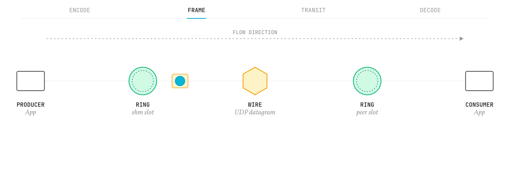
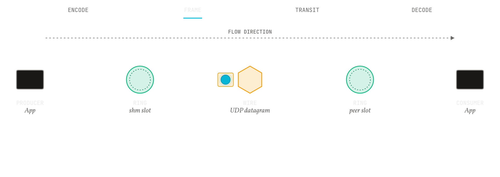

  
  
  Part 04 · Concepts
  <h1>Why it is shaped this way</h1>
  
One claim, the mechanism that makes it true, and what would refute it.

<b>Explanation</b> · for anyone who wants to understand the design before trusting it

An explanation page makes one claim about the design, shows the mechanism that makes it true, and says what would refute it. It does not give steps and it does not list facts for lookup; those belong in the other parts. This opener carries the first explanation, the shape of the whole system, because every later page assumes it.

- [Why a 128-byte atom](why-128-bytes.md), [Why content addressing](why-content-addressing.md): the two primitives.
- [The SeqLock memory model](seqlock-memory-model.md): the substrate; [Substrate versus contract](/docs/daemon/explanation/substrate-versus-contract.html), in the daemon's book, is where the substrate ends and the daemon's contract begins.
- [Transport design](transport-design.md): moving bytes between machines; [Daemon design](/docs/daemon/explanation/daemon-design.html) and [Trust boundaries](/docs/daemon/explanation/trust-boundaries.html), in the daemon's book, are moving them between processes.
- [Decision log](decision-log.md): what was decided.

<figure class="pm-figure">
  
  
  <figcaption>Figure A01 · end to end · producer, ring, store, transport, consumer</figcaption>
</figure>

## The shape of the system

The system is four tiers, and a tier depends only on the tiers below it. This repository holds the bottom two; the other two are repositories built on it.

| Tier | Where | What lives there | Color in every figure |
|---|---|---|---|
| 0 | `pulse/`, here | The canonical primitive: the Pulse, the PulseEnvelope, the codec that turns them into bytes, the conformance artifacts that pin those bytes, and the vocabulary (the Lexicon, the context and capability registries). | Cyan for the Pulse, violet for the envelope |
| 1 | `core/`, here | The engine: the SeqLock ring, the envelope store, the single-slot region, the reference UDP transport, the transport trait, the backoff and CRC primitives, and the macro the rings compose with. | Emerald for the substrate, amber for transport |
| 2 | `mesh/`, in the daemon | The fabric: the daemon and its port protocol, the embedded hub runtime, the Rust client, broadcast, health, the envelope basket. | Emerald and amber, by what each crate touches |
| 3 | the dev ring in the daemon; `rings/` in the profiles | Domain surfaces composed over the fabric: a dev ring, an enterprise ring, an HFT ring and a robotics ring. | Slate for what a figure excludes |

Beside the tiers, each repository has its leaves: here the `pulse` command line, the bindings, the examples and the fuzz harness; in the daemon the `pms` tools, the thin clients and the basket query tool; in the profiles the XDP plugin and the HFT telemetry tool. They consume the tiers and are consumed by nothing.

Every ring has the same four crates, and the shape is deliberate. `<ring>-core` holds the shared types the ring's other layers reuse, with no logic and no I/O. `<ring>-functions` holds stateless primitives. `<ring>-stages` holds the stateful processing: pipelines, lanes, delivery. `<ring>-hub` composes the three and is the only crate a downstream consumer depends on. A layer that has nothing to hold stays as an empty crate, so that every ring reads the same way. The macro that composes a hub, `register_stages!`, lives here in `core/mesh-stage-registry`, because it depends on nothing and every hub uses it.

The colors in the table are the website's and the book's: cyan is the Pulse, violet the envelope, emerald the substrate that holds them, amber the transport that moves them, rose an error or a mismatch, slate whatever a figure sets aside. A figure that uses them is self-describing once the legend is known.

## What would refute this

The claim is that the tiers depend only downward and that every ring keeps the four-crate shape. `cargo tree` over each workspace is the check, and `scripts/arch-check.py` runs it in every repository's gate: a tier-2 crate that depends on a tier-3 crate, a crate here that depends on the daemon or the profiles, or a ring whose hub is not the only entry point, contradicts the page.
