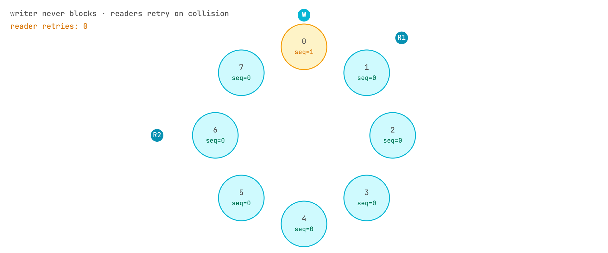
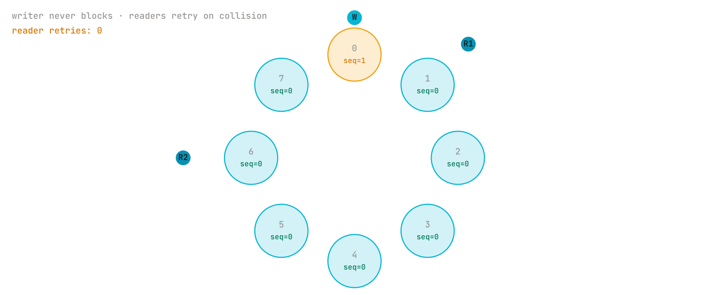
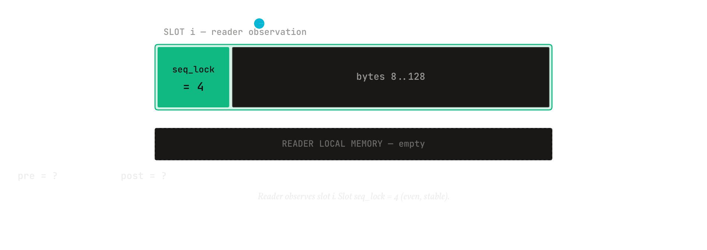

# The SeqLock memory model

<b>Explanation</b> · for anyone who wants to know why a reader can trust a Pulse it copied out of shared memory while a writer was running

**The claim.** A reader that observes the slot's sequence counter even and unchanged across its copy has a Pulse that one publish wrote in full, on any processor the tree targets, and a reader that cannot get such an observation within a bounded number of tries has learned that the slot is torn or abandoned, not that it should keep waiting.

<figure class="pm-figure">
  
  
  <figcaption>Figure A10 · the SeqLock · even is stable, odd is a write in progress</figcaption>
</figure>

## The mechanism

The counter in a slot's first eight bytes is a version number with a parity bit. A writer stores an odd value, copies the Pulse's other 120 bytes, then stores the next even value. A reader loads the counter, copies the slot, loads the counter again, and keeps the copy only if both loads were the same even number. If a write started during the copy, the second load is odd or larger; if a write completed between the loads, the number moved. The reader retries in either case. The writer never waits for anyone: a slow or absent reader costs it nothing, which is why a publish is a fixed few nanoseconds regardless of how many readers there are.

That is the algorithm on paper. What makes it true on hardware is the pair of fences. A processor and a compiler are free to reorder a plain store or load with the atomic operations around it, so without a fence the payload copy could become visible before the odd mark, or the reader's copy could be served after the second load. The writer therefore issues a release fence between the odd mark and the copy, and the reader an acquire fence between the copy and the second load. On x86 the hardware's ordering hides the bug, which is how the tree ran for months without one; on AArch64 it does not, and the fences were added after a torn-read test written for this Mac showed mixed bytes in a "consistent" Pulse. The test drives four readers against a writer and asserts that no reader ever sees a Pulse whose fill bytes disagree.

The copy itself is atomic too. The writer stores the 120 bytes after the counter, and the reader loads the slot, as relaxed atomic stores and loads of eight-byte words (`core_region::shm::store_words` and `load_words`). The fences order the copy against the counter, but they cannot make a plain memory copy that races a write defined: in Rust that is undefined behaviour even when the reader throws the copy away, and no test can show it absent. With every shared access atomic, a racing write can only make a copy stale, which the second counter load catches. On x86-64 and AArch64 a relaxed load or store of a word is an ordinary move, so the atomics cost nothing the hardware was not already doing.

<figure class="pm-figure">
  
  
  <figcaption>Figure A12 · the reader · two loads around the copy; a mismatch is a torn read</figcaption>
</figure>

## Crashed writers and bounded readers

A writer that dies between its two stores leaves the counter odd forever. Two rules keep that from becoming a hang. The reader's retry is bounded, one hundred spins in the reference, after which it reports nothing: for that slot the right answer is "no consistent Pulse here", not "wait longer". And the next writer to reach the slot reads the counter with its low bit cleared before marking it odd, so an abandoned odd counter is re-based and the slot becomes readable again after the next publish. Before that rule the publish paths computed their marks from the odd value and left the slot unreadable for the life of the region.

The same protocol protects the envelope store's slots and the single-slot region, and the SPMC ring in the HFT ring, with one addition in the store: the counter there encodes the lap, so a reader can tell that a slot holds the cursor it asked for and not the same slot from a previous pass around the ring; and a slot held by a writer that died there is not waited for, because the store's writers route around it to a fresh cursor and its readers skip it at once. The SPMC ring and the multilane lanes read the counter for the same purpose: a reader that has fallen a capacity behind is moved to the oldest publish still held, a copy the writer may have overwritten with the next lap is discarded, and both are counted as lost rather than delivered under an old index or delivered twice. The hub runtime's poll applies the same rule through the ring's `read_position`, with the slot counter serving as the lap count: each completed write adds two, so a stable copy whose counter shows more writes than its position's lap needs is discarded as lost.

## What it costs

Two counter stores, a fence and fifteen word stores per publish; two counter loads, sixteen word loads, a fence and a compare per read; and the possibility of a retry under contention. A reader that needs a slot while a writer is mid-publish spends nanoseconds spinning rather than blocking. What it does not cost is a lock, a syscall, or a writer that stalls on a reader.

## What would refute this

A reader returning a Pulse with bytes from two different publishes would refute the claim; the torn-read test is the check, and the fences are what make it pass on a weakly ordered processor. A reader that never returns from a slot whose writer died, or a slot that stays unreadable after a later publish, would refute the bounded-reader and crashed-writer rules; the crashed-writer tests are those checks.

## Spoken walkthrough

*A script for the video and audio version of this page, about ninety seconds.*

How does a reader trust a Pulse it copied while a writer was running? With a counter and two fences.

The counter is the slot's first eight bytes. A writer stores an odd number, copies the Pulse in, and stores the next even number. A reader loads the counter, copies the slot, loads the counter again, and keeps the copy only if both loads were the same even number. If a write began during the copy the second load is odd or larger; if one finished between the loads the number moved; either way the reader tries again. The writer never waits for anyone.

That is the algorithm. On hardware, two fences make it true: a release fence between the odd mark and the copy, an acquire fence between the copy and the second load, so neither the processor nor the compiler reorders them. On x86 you would never notice the fences missing. On ARM you would: a test written on an Apple-silicon Mac showed mixed bytes in a copy that the counter said was clean, until the fences went in.

Two rules keep a dead writer from hanging anyone: the reader gives up after a hundred tries and reports nothing, and the next writer re-bases an abandoned odd counter so the slot reads again after the next publish.

The cost: two counter stores, a fence and fifteen word stores to publish; two loads, sixteen loads, a fence and a compare to read. No lock, no syscall, no writer stalled on a reader.
