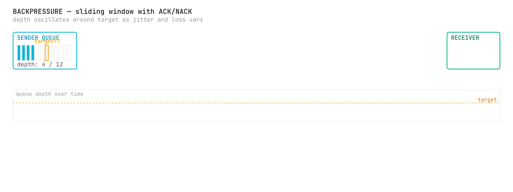
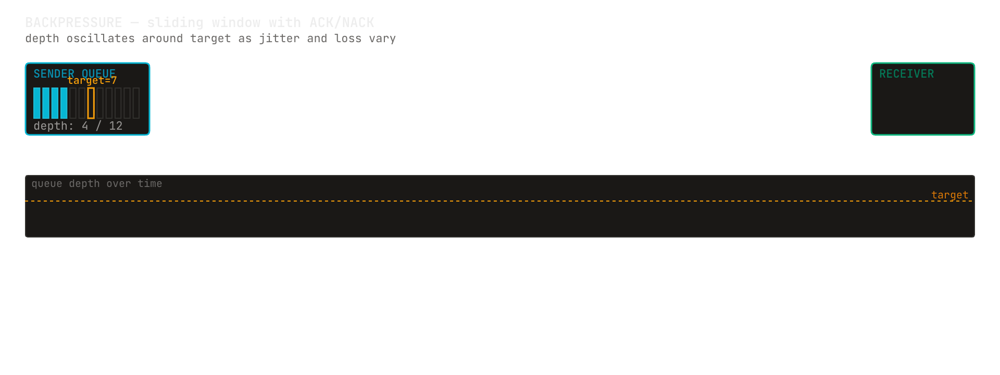
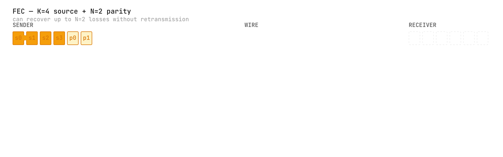
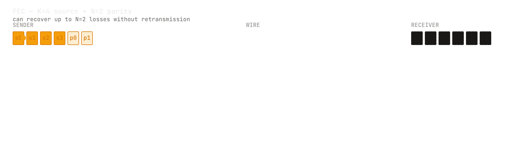

# Transport design: the feedback loop, retransmission and parity

<b>Explanation</b> · for anyone tuning the UDP transport or deciding which of its mechanisms a link needs

**The claim.** A fire-and-forget datagram transport becomes reliable enough for control traffic with three separable mechanisms, each of which costs something different: a feedback loop that keeps the sender from outrunning the receiver, a bounded retransmission path for the frames that are lost anyway, and a parity frame that recovers one loss per window without a round trip. None of them changes the frame a Pulse travels in.

<figure class="pm-figure">
  
  
  <figcaption>Figure A17 · backpressure · the acknowledgement cursor closes the loop</figcaption>
</figure>

## The feedback loop

The receiver tells the sender, once per millisecond, how far the stream has reached it: one number, its cursor, one past the highest sequence it has seen. The sender keeps the highest such number it has seen and refuses to send while more than a fixed number of frames (sixteen by default) are in flight beyond it, backing off from spins into short sleeps until the number moves or a deadline passes, five seconds by default, when the send fails instead of waiting forever; a cursor ahead of the sender, left by a receiver that outlived a restart, counts as nothing in flight. A batch of frames is held to the same rule one frame at a time, so batching buys the syscall and nothing else. The loop needs no negotiation and no state on the wire beyond the sequence number every frame already carries, and because the sender only ever raises its cursor, a replayed or reordered acknowledgement is harmless. What the loop does not do is guarantee delivery: a lost frame simply leaves a gap.

## Retransmission, bounded on both ends

The receiver names the gap: each missing sequence inside its recovery window is staged once, when the arrival that reveals it lands, and requested with a negative acknowledgement, at most sixteen per period, again after four periods if still missing, and at most three times in all; the sender answers from a cache of its last thousand encoded frames, byte for byte, to its own data destination. Every step is bounded because every step is an amplifier a peer or a fault could drive. A gap wider than the window keeps only its newest window staged; the receiver gives up the rest, counts them, moves past them and counts a resync, because a window the sender no longer holds cannot be recovered and staging it would only fill memory. The sender's queue of pending requests is capped at the cache size, it drains at most sixteen per send, and a request for a frame outside the cache is a counted miss. A forged request cannot redirect traffic, because the retransmission goes where the data goes, and the feedback socket can be told which peer to listen to.

## Parity instead of a round trip

On a long path the round trip a retransmission costs is the whole latency budget. Forward error correction spends bandwidth to save it: after every window of K frames the sender emits one parity frame, the exclusive or of the window, and a receiver that lost exactly one frame of the window rebuilds it from the other K − 1 and the parity, then decodes the rebuilt bytes through the same path as any frame, CRC included. Two losses in a window fall through to retransmission. K is the whole tuning knob: a small window recovers more often and costs more bandwidth; a large one costs less and recovers less. A window of zero is a configuration error and is refused.

<figure class="pm-figure">
  
  
  <figcaption>Figure A16 · forward error correction · one parity frame per window, one loss recovered</figcaption>
</figure>

## The mechanisms added since

Four more sit beside the three, each opt-in and each leaving the frame alone. Congestion control sizes the backpressure window to the path: a window of frames in flight that grows while acknowledgements advance and halves on loss, with optional pacing across a round trip. Fragmentation sends an envelope up to `MAX_MESSAGE` (66,560 bytes) as a run of datagrams, which the receiver reassembles within a bound; switched on at both ends, it moves the per-datagram limit without touching the frame. Delivery options put a sequencer between the intake and the caller, for duplicate suppression (a sequence number can arrive twice with NACK or FEC on) and in-order delivery with a per-gap timeout. Multicast sends once to a group that every member receives. Sealing, ADR-0018's authenticated and encrypted datagrams, wraps whatever the transport would have sent, fragments and feedback included, and is described under [Trust boundaries](/docs/daemon/explanation/trust-boundaries.html); its review is pending.

## Choosing

Each mechanism is switched on by configuration, on both ends where it needs both. The capability Hello that lets two peers announce what they can do exists, and the daemon's links exchange it inside their sealed session; on plain UDP nothing sends it yet, and nothing acts on an agreed upgrade yet, so choosing is still the operator's. A local link needs none of these; a lossy link with a short round trip wants retransmission; a long, lossy link wants parity in front of retransmission; any link where the receiver is slower than the sender wants the feedback loop first, with congestion control when the path, not the receiver, is the limit; and a message larger than a datagram wants fragmentation at both ends.

## What would refute this

A sender that keeps sending past the receiver's cursor, a retransmission that goes to the address a request came from, an unbounded queue of requests, a window with one loss that is not recovered, or a parity frame that decodes to bytes the CRC does not accept would each refute a claim above. The transport's backpressure, retransmission, gap-bound, queue-bound, feedback-filter and parity tests are the checks, and each runs over loopback in the workspace test suite.

## Spoken walkthrough

*A script for the video and audio version of this page, about ninety seconds.*

UDP forgets. The transport makes it remember enough for control traffic, with mechanisms you switch on one at a time, none of which changes the frame a Pulse travels in.

First, the feedback loop. Once a millisecond the receiver tells the sender how far the stream has reached it, one number, and the sender refuses to run more than a few frames past it. No negotiation, no new state on the wire.

Second, retransmission. The receiver names the frames it is missing, a bounded number at a time, a bounded number of times, and the sender answers from a bounded cache. Every step is bounded, because every step is something a peer or a fault could drive.

Third, parity. On a long path the round trip is the whole budget, so after every window of frames the sender adds one parity frame, and a receiver that lost one frame rebuilds it without asking.

Since then: a congestion window on the feedback, fragmentation for envelopes larger than a datagram, in-order and duplicate-free delivery, multicast, and sealing, which is authenticated encryption awaiting its independent review.

A local link needs none of these. A lossy link wants retransmission. A long lossy link wants parity in front of it. A slow receiver wants the feedback loop first.
