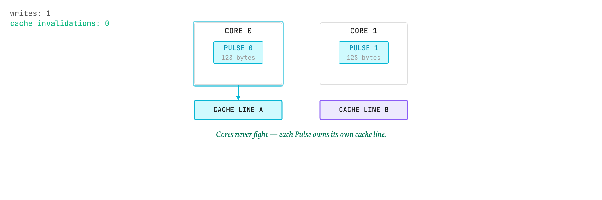
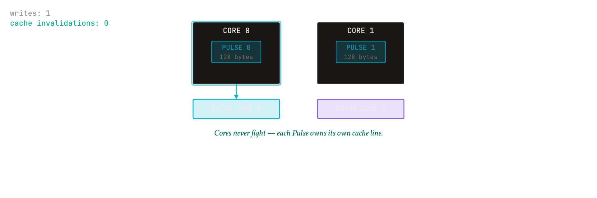

# Why a 128-byte atom

<b>Explanation</b> · for anyone deciding whether a fixed-size control signal is the right primitive, and why this size

**The claim.** A control signal that is exactly two cache lines, aligned to one, can be read with two memory fetches and no parsing, and can be moved through shared memory without a lock. Every other property of the Pulse follows from choosing that size and alignment before choosing the fields.

<figure class="pm-figure">
  
  
  <figcaption>Figure A04 · cache-line alignment · two cores, adjacent slots, with and without a 64-byte boundary</figcaption>
</figure>

## The mechanism

A processor moves memory in cache lines, 64 bytes on the x86-64 and AArch64 machines this tree targets. A structure that starts on a line boundary and is a whole number of lines long is fetched line by line with nothing wasted and nothing shared: no byte of it sits in a line that also holds a neighbour's data. That last point is the one that matters for a ring. If two slots shared a line, a writer publishing into one slot would invalidate the line in every core reading the other, and the readers would pay for a write they never asked about. That is false sharing, and 64-byte alignment removes it by construction.

Two lines rather than one is a decision about what the signal must carry. The first line holds identity and routing: the SeqLock word the substrate owns, the 16-byte origin, the monotonic clock reading, the chain step, the instruction, the scope, and the 16-byte reference to an envelope. The second holds 32 bytes reserved for a replay defence that this release does not implement, and 32 bytes whose meaning follows the instruction: a heartbeat's vitals, or, for a Data pulse, which stored copy of its envelope to fetch. A single line could not hold a content reference and an origin and a clock; three lines would carry padding on every hot path for a payload that belongs in an envelope anyway. Two is the smallest whole number of lines that carries a complete signal.

Fixed size is what makes the ring a ring. Slot *i* is at a fixed offset, so a reader needs no index and a writer needs no allocator; the cursor modulo the capacity is the whole addressing scheme. It is also what makes the SeqLock cheap: the counter is the first eight bytes of the slot, the copy is a constant 120 bytes, and the reader's check is two loads and a compare.

## What the size costs

A Pulse cannot carry a payload. Anything larger than its fields travels as a PulseEnvelope, referenced by content, which means a second read for any message with data. The design accepts that cost deliberately: the reference to the envelope is itself content-addressed, so the second read is a lookup by identity in a store where identical content is held once, and the Pulse stays a signal that a million-per-second control loop can afford.

## What would refute this

The claim rests on a Pulse being 128 bytes and 64-byte aligned, which the codec asserts at compile time, and on false sharing being absent, which the ring's torn-read test exercises with four readers against one writer. A measurement in which a reader's latency rises when a writer publishes into an adjacent slot would contradict the alignment argument; a Pulse layout whose fields no longer fit two lines without a payload would contradict the size argument.

## Spoken walkthrough

*A script for the video and audio version of this page, about a minute.*

A processor moves memory sixty-four bytes at a time, and that one fact decides the size of a Pulse. Make the signal exactly two of those lines, start it on a line boundary, and every read is two fetches with nothing wasted and nothing shared with a neighbour. Share a line between two slots and a writer in one slot slows every reader of the other. So: one hundred and twenty-eight bytes, aligned.

Why two lines and not one? The first holds who and where: the counter, the origin, the clock, the instruction, the scope, and a reference to an envelope. The second holds room for a replay defence this release does not yet implement, and thirty-two bytes that follow the instruction: the vitals a heartbeat carries, or where a data pulse's envelope sits in the store. One line could not hold a reference and an origin and a clock; three would pay for padding on every message.

The cost is that a Pulse carries no content of its own. Anything bigger travels as an envelope, named by its content, fetched by that name. The Pulse stays a signal that a million-per-second loop can afford.
