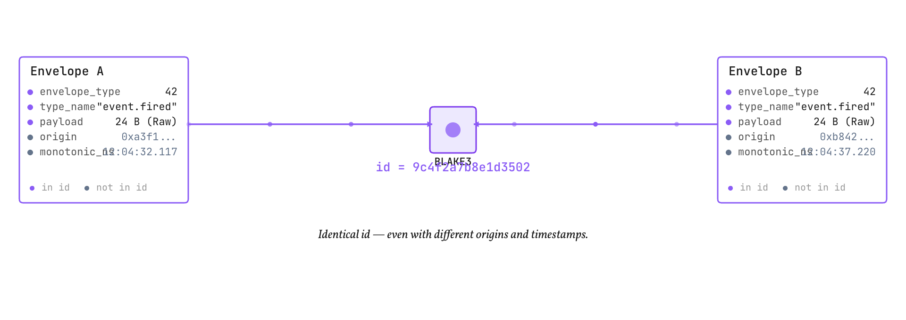
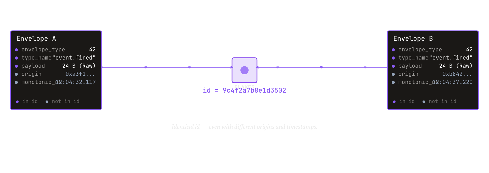
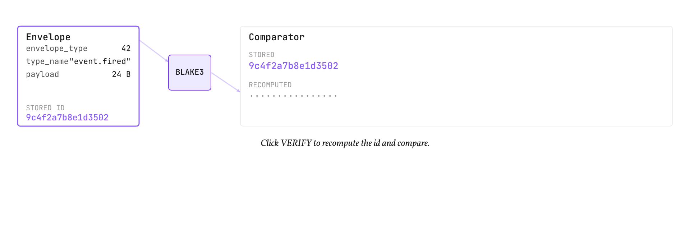
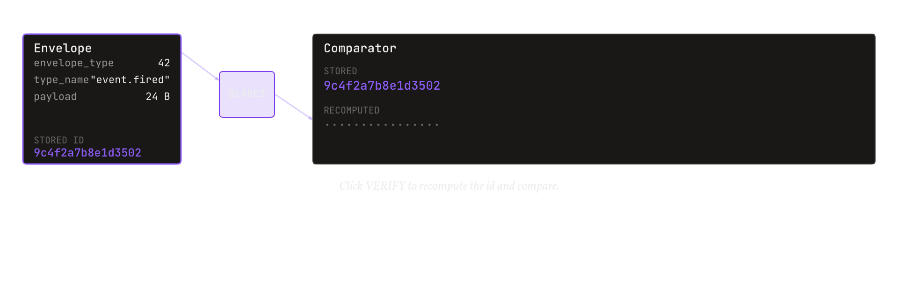

# Why content addressing

<b>Explanation</b> · for anyone asking why an envelope is named by a hash of its bytes rather than by a sequence number or a sender-assigned id

**The claim.** Naming an envelope by the BLAKE3 hash of its canonical bytes gives every implementation, in every language, the same name for the same content, without coordination; and that one property is what makes cross-language byte equality checkable, storage deduplicating, and a nested envelope tamper-evident.

<figure class="pm-figure">
  
  
  <figcaption>Figure A06 · content addressing · one preimage, one identifier, every language</figcaption>
</figure>

## The mechanism

The identifier is computed from what the content is, not from who produced it or when: the envelope type, the type name if any, the payload variant and the payload bytes, each length-prefixed, under a fixed domain tag. Origin, timestamp and flags stay outside the preimage, so two producers that emit the same event get the same identifier and can be deduplicated, and a router that flips a flag does not change what the envelope is named. The domain tag is the part that keeps the name honest across the whole stack: a hash of the same bytes computed for some other purpose can never collide with an envelope identifier, because the tag is different.

Because the name is a function of the bytes, equality of names is equality of content. That is the test the conformance vectors run: an implementation that reproduces the vector's identifier from the vector's fields has reproduced the canonical bytes, byte for byte, because any difference in the bytes would change the hash.

The nested variant turns the property into provenance. A parent's identifier covers its children's canonical bytes, and each child's canonical bytes begin with the child's own identifier; change a leaf and every identifier above it changes. A batch of events, an audit chain of states, a broadcast of a bundle: each is one envelope whose single identifier vouches for everything inside it.

<figure class="pm-figure">
  
  
  <figcaption>Figure A09 · verify · recompute and compare</figcaption>
</figure>

## What it costs

A hash over the payload on every encode, and, when a receiver verifies, on every decode; the reference makes verification a separate call so a trusted shared-memory path can skip it and an untrusted network path cannot. Sixteen bytes of identifier instead of eight of sequence number. And a discipline: the canonical bytes must be exactly specified, because any freedom in the encoding would let two implementations agree on the content and disagree on the name.

## What would refute this

Two conformant implementations producing different identifiers for the vectors' inputs would refute the claim outright. So would a demonstrated collision at the 16-byte width for two distinct canonical byte strings, or an identifier that changed when only the origin, the timestamp or a flag changed.

## Spoken walkthrough

*A script for the video and audio version of this page, about a minute.*

An envelope's name is a hash of its bytes. Not a sequence number, not something the sender chose: the type, the type name, the payload, each with its length, under a fixed tag. The origin and the time stay out, so two producers of the same event produce the same name, and a router that flips a flag changes nothing about what the envelope is.

Because the name is a function of the bytes, equal names mean equal content. That is what the conformance vectors test: reproduce the identifier and you have reproduced the bytes, in any language.

Nest envelopes and the property becomes provenance: a parent's name covers its children's bytes, so change a leaf and every name above it changes. One identifier vouches for everything inside.

The price is a hash on every encode and, when you verify, on every decode; sixteen bytes of name instead of eight of sequence; and a canonical encoding with no freedom in it, because any freedom would let two implementations agree on the content and disagree on the name.
